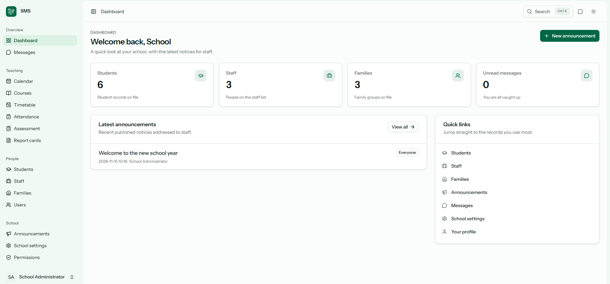
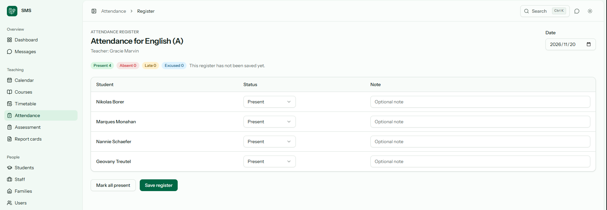
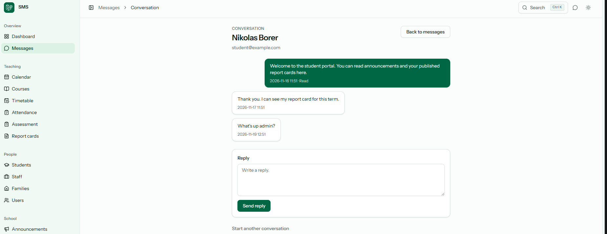

# School Management System

A single-school management system built with Laravel 13, Inertia.js v3, Vue 3 and Tailwind CSS v4. It covers the core day-to-day school workflows: people and user accounts, the academic calendar, curriculum, class timetables, attendance registers, assessments, report cards, announcements, direct messages, and a read-only portal for students and families.

The application uses email-only login, a role and permission matrix, and a responsive dashboard-style interface.

## Screenshots

**Administrator dashboard** — school-wide counts, recent announcements and quick links.



**Attendance register** — take attendance per class, with per-student status and notes.



**Internal messaging** — one-to-one conversations between staff and portal users.



**Report card** — published results, attendance summary and print/PDF export.


## Requirements

| Requirement | Version |
| --- | --- |
| PHP | 8.3 or newer (8.4 recommended) |
| Composer | 2.x |
| Node.js | 22 or newer |
| npm | Included with Node.js |
| Database | SQLite (default), MySQL 8+, or PostgreSQL |

Required PHP extensions: `pdo_sqlite` (or `pdo_mysql` / `pdo_pgsql`), `mbstring`, `openssl`, `dom`, `fileinfo`, `curl`, and `zip`. The `dom` extension is needed for PDF export and `zip` for spreadsheet export.

## Installation

### Shortcut (recommended)

Clone the repository and enter the project directory:

```bash
git clone https://github.com/sivuyilekoba/school-management-system.git
cd school-management-system
```

For the default SQLite database, create the database file before running setup — it is not committed to the repository:

```bash
# macOS / Linux
touch database/database.sqlite
```

```powershell
# Windows PowerShell
New-Item database/database.sqlite -ItemType File
```

Then run setup and seed:

```bash
composer setup
php artisan db:seed
```

`composer setup` installs the PHP and npm dependencies, creates `.env`, generates the application key, migrates the database and builds the frontend assets. It does **not** seed the database, so `php artisan db:seed` must be run separately. See [Database setup](#database-setup) if you are using MySQL or PostgreSQL.

### Manual setup

If you prefer to run each step yourself, start by cloning the repository (skip this if you already cloned it above):

```bash
git clone https://github.com/sivuyilekoba/school-management-system.git
cd school-management-system
```

1. **Install PHP dependencies**

   ```bash
   composer install
   ```

   `composer install` copies `.env.example` to `.env` for you on a fresh clone. If it does not, create it manually:

   ```bash
   cp .env.example .env
   ```

   On Windows PowerShell: `Copy-Item .env.example .env`

2. **Generate the application key**

   ```bash
   php artisan key:generate
   ```

3. **Prepare the database** — create `database/database.sqlite` as shown in the shortcut section above, then run:

   ```bash
   php artisan migrate
   ```

4. **Seed the demo data**

   ```bash
   php artisan db:seed
   ```

5. **Install and build the frontend**

   ```bash
   npm install
   npm run build
   ```

## Database setup

### SQLite (default)

The shipped `.env` uses SQLite:

```dotenv
DB_CONNECTION=sqlite
```

Laravel uses `database/database.sqlite` by default. Create that file, then run:

```bash
php artisan migrate
php artisan db:seed
```

### MySQL or PostgreSQL

Create an empty database, then update `.env` with the matching values:

```dotenv
DB_CONNECTION=mysql       # or pgsql
DB_HOST=127.0.0.1
DB_PORT=3306              # use 5432 for PostgreSQL
DB_DATABASE=school_management
DB_USERNAME=root
DB_PASSWORD=secret
```

Then migrate and seed:

```bash
php artisan migrate
php artisan db:seed
```

Sessions, the cache and the queue all use the `database` driver in `.env.example`, so the migrations must be run before the application can store login sessions.

### What seeding does

`php artisan db:seed` always creates:

- the roles (Administrator, Teacher, Student, Parent, Support Staff);
- the full permission catalogue, granted **only** to the Administrator role;
- the default school settings.

When `APP_ENV=local`, it also creates demo people, courses, classes, timetables, attendance, assessments, report cards, announcements, sample messages, and the demo logins listed below. Seeding is safe to re-run: it uses `firstOrCreate` / `updateOrCreate` for the demo accounts.

To reset the database from scratch:

```bash
php artisan migrate:fresh --seed
```

> Note: `migrate:fresh --seed` resets non-admin roles to zero permissions. Grant permissions again through the Permissions page if you do this in your local database.

## Running the application

### Development (all-in-one)

```bash
composer run dev
```

This starts three processes concurrently: the PHP development server, the queue worker, and the Vite dev server. Open <http://localhost:8000>.

### Development (two terminals)

```bash
php artisan serve
```

```bash
npm run dev
```

The queue worker is only needed if you dispatch queued jobs. Start it with `php artisan queue:listen --tries=1`.

### Production build

```bash
npm run build
php artisan optimize
```

Serve the `public/` directory with your web server. If you see `Unable to locate file in Vite manifest`, run `npm run build` (or keep `npm run dev` running).

## Demo accounts

Available after seeding with `APP_ENV=local`. The password is `password` for all accounts.

| Role | Email | Notes |
| --- | --- | --- |
| Administrator | `admin@example.com` | Full access, including the permission matrix |
| Student | `student@example.com` | Linked to a demo student record |
| Parent | `parent@example.com` | Linked to one demo family |

Additional staff accounts (including teachers) are created by an administrator under **Users**. No teacher demo login is seeded.

Roles other than Administrator start with **no permissions**. An administrator can grant them at <http://localhost:8000/school/permissions>; changes take effect after the user logs out and back in.

## Project structure

| Path | Purpose |
| --- | --- |
| `app/` | Models, controllers, form requests, enums and services |
| `routes/` | Web routes split by area (`school.php`, `portal.php`, `messages.php`, ...) |
| `resources/js/pages/` | Inertia/Vue pages, grouped by `school/`, `portal/` and `messages/` |
| `resources/js/components/` | Shared UI components (tables, forms, layouts, status badges) |
| `database/migrations/` | Schema migrations |
| `database/seeders/` | Roles, permissions, settings and local demo data |
| `config/permissions.php` | Permission catalogue shown in the permission matrix |
| `tests/` | Pest feature tests |

## Development commands

| Command | Description |
| --- | --- |
| `composer run dev` | Start the server, queue worker and Vite together |
| `npm run build` | Build production assets |
| `npm run types:check` | Type-check Vue/TypeScript with `vue-tsc` |
| `npm run check` | Check formatting and lint rules for frontend files |
| `npm run check:fix` | Fix frontend formatting and lint issues |
| `composer lint` | Format PHP files with Pint |
| `composer lint:check` | Check PHP formatting without changing files |
| `composer types:check` | Run PHPStan |
| `php artisan test` | Run the Pest test suite |
| `composer ci:check` | Run frontend checks, type checks and the test suite |
